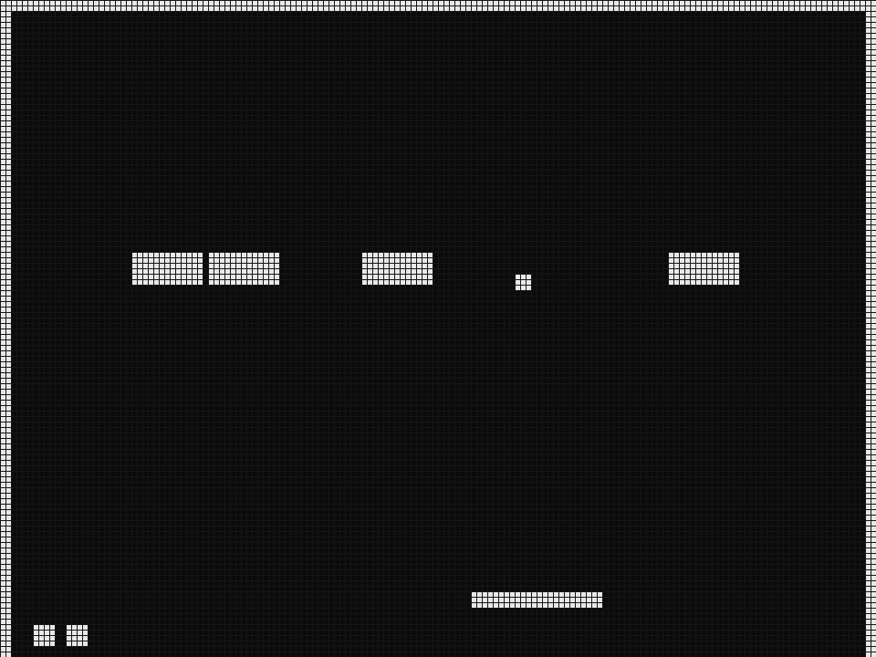

# mistang-core-breakout

Breakout for MiSTang (Sipeed Tang Nano 20K). Written from scratch.

- `rtl/breakout_game.sv`: game logic (ball, paddle, 10x5 bricks, 3 lives, level restart). S1/S2 move the paddle; idle for 3 s and the paddle plays itself.
- `rtl/breakout_pixel.sv`: monochrome playfield, 160x120.
- `rtl/top/breakout_top.sv`: 720p60 HDMI (6x scale), UART screenshot stream (`BRKO` + 2400 bytes).
- `tools/refbreakout.py`: independent reference model. `./test.sh` runs the RTL in iverilog for 120..9000 ticks and compares the whole frame with it (all PASS).
- `build.sh`: yosys + nextpnr + gowin_pack. Timing: pixel clock 121.9 MHz (needs 74.25), game clock 82.2 MHz (needs 12).
- `tools/capture_win.py` / `tools/capture.py`: screenshot over the USB-UART (Windows / macOS-Linux).

Package for the launcher: `python tools/mkcore.py build/breakout_top/breakout_top.fs --id breakout --name Breakout -o dist/`.

## Screenshots
Real capture from the board (core loaded from flash slot A through the MiSTang launcher's multiboot jump):

Simulation frame after 200 ticks: `docs/img/sim-breakout.png`.

## Status
Runs on a real Tang Nano 20K (2026-11-04): game logic plays, UART frame captured. HDMI output was not looked at on a display in this session.

## License
GPL-3.0 (see LICENSE). `rtl/hdmi/` is hdl-util/hdmi (MIT/Apache-2.0) as used in Open Pocket GBC; the game logic, pixel module and reference model are original.
